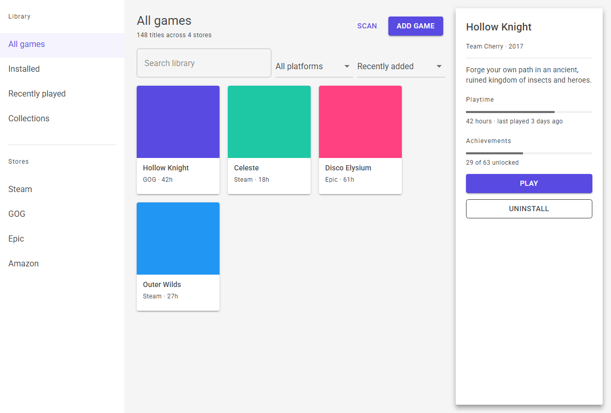

# Fili - MudAvalonia Theme

[](https://www.nuget.org/packages/Fili.MudAvalonia.Theme)
[](https://www.nuget.org/packages/Fili.MudAvalonia.Theme)
[](https://github.com/FiliArrochada/Fili.Theme.MudAvalonia/actions/workflows/build.yml)
[](https://filiarrochada.github.io/Fili.Theme.MudAvalonia/)
[](https://avaloniaui.net/)
[](LICENSE)

MudBlazor's look for Avalonia 12: its palette, elevation, typography and geometry, in light, dark
and high contrast. Every control arrives themed by type, and MudBlazor's variants are style
classes with MudBlazor's names, so `<Button Classes="filled primary">` is
`<MudButton Variant="Variant.Filled" Color="Color.Primary">`.



The same screen in [dark](tst/Fili.Theme.MudAvalonia.PixelTests/Baselines/screen-dark.png) and
[high contrast](tst/Fili.Theme.MudAvalonia.PixelTests/Baselines/screen-highcontrast.png). Each is a
pixel frame the test suite compares on every build.

**[Read the docs](https://filiarrochada.github.io/Fili.Theme.MudAvalonia/)**, laid out as
mudblazor.com is: a page per component with live examples, their code, a link to the MudBlazor
page and a parity table. The site is the gallery app itself, built with the theme it documents and
compiled to WebAssembly; every page has its own address (`#button`, `#tooltip`).

It is a theme, not a component library: no new control types, no services, and one public type.
The token values are MudBlazor's defaults, transcribed from its source rather than eyeballed.

## Quick start

```bash
dotnet add package Fili.MudAvalonia.Theme
```

Then two includes in `App.axaml`, base first and Fili second, because later styles win:

```xml
<Application.Styles>
  <StyleInclude Source="avares://Fili.Theme.MudAvalonia/Themes/Base/FiliBaseTheme.axaml" />
  <StyleInclude Source="avares://Fili.Theme.MudAvalonia/FiliTheme.axaml" />
</Application.Styles>
```

No `FluentTheme`, no `SimpleTheme`, no `Avalonia.Themes.*` package: the base is this package's own
fork of Avalonia's Simple templates ([The base](docs/the-base.md)). Then use classes for variants
and tokens by key:

```xml
<Border Classes="paper elevation4" Padding="16">
  <StackPanel Spacing="4">
    <TextBlock Classes="h6" Text="Section" />
    <TextBlock Classes="caption" Text="Supporting line" />
    <TextBlock Classes="body2 error" Text="Could not reach the store" />
    <Button Classes="filled primary" Content="Retry" />
  </StackPanel>
</Border>

<Border Background="{DynamicResource FiliPrimaryBrush}" />
```

**Always `DynamicResource`, never `StaticResource`**, for a token. A misspelt key resolves to
nothing in Avalonia, silently, and a `StaticResource` freezes the light value, so that control
stops following the variant. Switch variants on the `Application`:

```csharp
Application.Current!.RequestedThemeVariant = ThemeVariant.Dark;               // or Light
Application.Current!.RequestedThemeVariant = FiliThemeVariants.HighContrast;  // x:Static in XAML
```

**Publish with ReadyToRun** for a faster start: loading the theme the first time is mostly the JIT
compiling its XAML, about 300 ms on a desktop, and under 100 with
`<PublishReadyToRun>true</PublishReadyToRun>` in the app's project.

## Where to read what

| If you want to | Read |
|---|---|
| write a MudBlazor screen in AXAML | [From MudBlazor](https://filiarrochada.github.io/Fili.Theme.MudAvalonia/#from-mudblazor): the same UI written both ways |
| use one control | its page on [the docs site](https://filiarrochada.github.io/Fili.Theme.MudAvalonia/): examples, code and behaviour |
| find the class or key for one parameter | the parity table on its component's page; [MudBlazor parity](https://filiarrochada.github.io/Fili.Theme.MudAvalonia/#parity) lists every component |
| know what is not there | [MudBlazor parity](https://filiarrochada.github.io/Fili.Theme.MudAvalonia/#parity), "What is not here", and each page's Missing rows |
| theme it: colours, type, high contrast, right to left, reduced motion | the docs site's Customization pages, from [Theming](https://filiarrochada.github.io/Fili.Theme.MudAvalonia/#theming) |
| upgrade | [Versions](docs/versions/README.md): what changed, and what to change; [Compatibility](docs/compatibility.md): what a version promises not to change |
| work on the theme itself | [Traps](docs/traps.md), [The base](docs/the-base.md), [Testing](docs/testing.md), [Releasing](docs/releasing.md) |

## Install

The NuGet package keeps its original id, **`Fili.MudAvalonia.Theme`**: a nuget.org id is
permanent, and this one already has downloads. Everything else - the assembly, the namespaces,
the `avares://` paths and the repository - is `Fili.Theme.MudAvalonia`.

```xml
<PackageReference Include="Fili.MudAvalonia.Theme" Version="0.26.0" />
```

Under Central Package Management the version goes in `Directory.Packages.props` instead, as
`<PackageVersion Include="Fili.MudAvalonia.Theme" Version="0.26.0" />`, and the reference stays
version-less.

| | |
|---|---|
| Package | [`Fili.MudAvalonia.Theme`](https://www.nuget.org/packages/Fili.MudAvalonia.Theme) on nuget.org, with symbols (`.snupkg`) |
| Target framework | `net10.0` |
| Depends on | `Avalonia` 12.1.3 or later, and nothing else. `Avalonia.Controls.DataGrid` is optional: built against 12.1.0, themed when the app references it. [Which versions were tested](docs/releasing.md#supported-avalonia-versions) |
| Fonts | Roboto (Light, Regular, Medium) embedded, under the SIL Open Font License |
| Licence | MIT |

## Classes are variants

Every control the theme templates is keyed to its **type**, so it arrives themed with no markup
change. A class only ever names a MudBlazor **variant** - `Button.primary`, `TextBox.filled`,
`ProgressBar.large` - as `Color.Primary` and `Variant.Filled` do there. Two classes are Material's
rather than MudBlazor's, and named so: `material-fixed-tabs` on a tab bar and
`material-elevation-overlay` on a container, the dark-theme elevation overlay.

**An unclassed `<Button>` is the text button**, because `MudButton.Variant` defaults to
`Variant.Text`; and a colour class is only a colour, so `primary` alone is a primary *text*
button. Most components default to `Color.Default`, which is grey, not primary.

**A MudBlazor option that is one property of its control is that property, not a class.**
`Square` on a paper is `CornerRadius="0"`, a data grid's `Bordered` is
`GridLinesVisibility="All"`, a toolbar's `Gutters="false"` is `Padding="0"`. The whole list is in
[MudBlazor parity](https://filiarrochada.github.io/Fili.Theme.MudAvalonia/#parity), "Properties, not classes".

### Grep your app before adopting

**The class names are MudBlazor's vocabulary, and they collide on purpose**: `primary`, `small`,
`flat`, `outlined`, `error` are not namespaced, because API familiarity is the point. The cost is
that **an app that already uses those words gets its controls retemplated the moment it includes
the theme.** One early adopter collided on `primary` in 20 places on its first day: nothing broke
visibly, but hover and press were driven by its own fill and the theme's state layer at once. The
fix is to let the theme own shape and interaction and keep the app's colour. Grep for
`Classes="` against this list, which is a published interface
([Compatibility](docs/compatibility.md)) and pinned in both directions by `ClassVocabularyTests`.

**All 183 classes:**

| | |
|---|---|
| Type ramp (`TextBlock`) | `h1`–`h6`, `subtitle1`, `subtitle2`, `body1`, `body2`, `button`, `caption`, `overline` |
| Surfaces (`Border`; a popover's through `FlyoutPresenterClasses`, or on a `ContextMenu`) | `paper`, `appbar`, `square`, `elevation0` to `elevation25` (all 26 of MudBlazor's levels) |
| Overlay (`Border`) | `overlay`, `dark-background`, `light-background` |
| Colour (`Color`) | `primary`, `secondary`, `tertiary`, `info`, `success`, `warning`, `error`, `dark`, `inherit`; `default` on a toggle only, whose no-class colour is primary |
| Shape (`Variant`) | `text`, `filled`, `outlined`, `rounded`, `flat` |
| Size (`Size`) | `small`, `medium`, `large`, `dense` |
| Placement | `inset`, `middle`, `vertical`, `light`, `underline`, `no-underline`, `border`, `centered`, `hide-indicator` |
| Component | `icon`, `button-group`, `chip`, `fab`, `extended`, `list-item`, `alert`, `avatar`, `badge`, `card`, `skeleton`, `subheader`, `circle`, `rectangle`, `counter`, `circular`, `nav`, `toolbar`, `drawer-header`, `normal`, `newest-on-top`, `expansion-panels` |
| Card parts (a `StackPanel`, `DockPanel`, `Grid`, `WrapPanel`, `Border`, `TextBlock`, `Button` or `Image`) | `card-header`, `card-header-avatar`, `card-header-content`, `card-header-actions`, `card-media`, `card-content`, `card-actions` |
| Badge (`Origin`, `Dot`, `Bordered`, `Overlap`), and the table's `Bordered` | `top-left`, `top-center`, `center-left`, `center-center`, `center-right`, `bottom-left`, `bottom-center`, `bottom-right`, `dot`, `bordered`, `overlap` |
| Behaviour | `always-show-scroll-buttons`, `arrow`, `arrows-top`, `arrows-bottom`, `bullets-top`, `bullets-center`, `check-mark`, `clearable`, `dense-items`, `editable`, `helper-on-focus`, `hide-close`, `hide-icon`, `hover`, `loading`, `multi-expansion`, `multi-selection`, `no-animation`, `no-arrows`, `no-bullets`, `no-gutters`, `no-outline`, `no-paper`, `placeholder`, `required`, `shrink-label`, `value-label`, `striped`, `wave` |
| Label placement (`LabelPlacement`) | `label-start`, `label-top`, `label-bottom` |
| Icons in content | `start-icon`, `end-icon` |
| Material, not MudBlazor (the overlay on a window, a `UserControl`, a layout panel, `Border`, `ScrollViewer` or `ContentControl`) | `material-fixed-tabs`, `material-elevation-overlay` |
| Tab indicator colour (`SliderColor`) | `indicator-primary`, `indicator-secondary`, `indicator-tertiary`, `indicator-info`, `indicator-success`, `indicator-warning`, `indicator-error`, `indicator-dark` |
| Unchecked colour (`UncheckedColor`) | `unchecked-primary`, `unchecked-secondary`, `unchecked-tertiary`, `unchecked-info`, `unchecked-success`, `unchecked-warning`, `unchecked-error`, `unchecked-dark`, `unchecked-inherit` |
| Select arrow colour (`AdornmentColor`) | `adornment-primary`, `adornment-secondary`, `adornment-tertiary`, `adornment-info`, `adornment-success`, `adornment-warning`, `adornment-error`, `adornment-dark`, `adornment-inherit` |
| Switch thumb icon colour (`ThumbIconColor`) | `thumb-primary`, `thumb-secondary`, `thumb-tertiary`, `thumb-info`, `thumb-success`, `thumb-warning`, `thumb-error`, `thumb-dark` |

An app upgrading from a version before the theme keyed controls by type can delete any
`Classes="fili"`: the marker class is gone and does nothing.

## Behaviour worth knowing

- **Button labels are uppercase**, as MudBlazor's `Typography.Button.TextTransform` makes them; tabs
  always, as `.mud-tab` hard-codes it. `<x:String x:Key="FiliButtonTextTransform">none</x:String>`
  in a control's or the application's resources keeps labels as written
  ([Button](https://filiarrochada.github.io/Fili.Theme.MudAvalonia/#button), "Label case").
- **A press ripples**, from the pointer, on buttons, chips, toggles, tabs, rows and the halo of a
  checkbox, radio or switch. `FiliRippleOpacity` and `FiliRippleOpacitySecondary` set to `0` turn
  it off, MudBlazor's `Ripple="false"`.
- **Reduced motion is one key**, which MudBlazor does not have: `FiliReducedMotion` set to `True`
  in the application's resources stops everything the theme moves or fades on its own, in every
  window and popup ([Reduced motion](https://filiarrochada.github.io/Fili.Theme.MudAvalonia/#reduced-motion)).
- **A `DataGrid` is MudDataGrid with nothing to opt into.** The package does not depend on
  `Avalonia.Controls.DataGrid`; when the app references it, the theme finds it and themes its
  controls by type ([Data grid](https://filiarrochada.github.io/Fili.Theme.MudAvalonia/#data-grid)).
- **Unclassed text keeps the font's natural line height.** The type ramp sets `LineHeight` on its
  own classes and never on every `TextBlock`, so an app's own headings are not clipped.
- **The package ships no icon set**: only the glyphs its templates draw, each a key an app can set
  in a control's `Resources` to swap that control's icon, as MudBlazor's icon parameters do.

## Tokens

| Group | File | Notes |
|---|---|---|
| Palette | `Themes/Palette.axaml` | Light, dark and high contrast. Every colour has a `*Color` and a `*Brush` key: bind the brush. |
| Elevation | `Themes/Elevation.axaml` | Levels 0–25, MudBlazor's shadows, the same in light and dark; a 1px ring in high contrast. |
| Typography | `Themes/Typography.axaml` | Roboto, embedded; base size **14px**, not 16. |
| Controls | `Themes/ControlThemes.axaml` | One file per control under `Themes/Controls/`, keyed by type. |
| Icons | `Themes/Icons.axaml` | The Material glyphs the templates draw. Not an icon set. |
| Geometry | `Themes/Geometry.axaml` | 4px radius, 4px spacing scale, app bar and drawer sizes. |

Every key is listed in [Published keys](docs/published-keys.md). The primary differs by variant:
`#594AE2` in light, `#776BE7` in dark.

## Fonts, and the browser

Roboto is embedded in the three weights the theme uses, and covers Latin, Greek and Cyrillic. On
desktop a script it lacks falls back to the operating system's fonts. **A browser build has no
system fonts**, so Arabic, Hebrew or CJK text renders as nothing until the app embeds a face for it
and registers it with `FontManagerOptions.FontFallbacks`. Which scripts to ship is the app's
decision; the gallery's `GalleryFonts` is a worked example, with Noto Sans Arabic.

## The gallery

The docs site runs locally too, on desktop or in the browser:

```powershell
dotnet run --project src/Fili.Theme.MudAvalonia.Gallery.Desktop
dotnet workload install wasm-tools     # once, for the browser head
dotnet run --project src/Fili.Theme.MudAvalonia.Gallery.Browser
```

Its app bar switches light, dark and high contrast, the primary colour and right to left at
runtime, and its performance toggle shows Avalonia's frame and layout graphs with each page's
visual count and build time.

## Working on it

```
src/Fili.Theme.MudAvalonia                  the theme (the NuGet package, id Fili.MudAvalonia.Theme)
src/Fili.Theme.MudAvalonia.Gallery          gallery and docs site, shared across heads
src/Fili.Theme.MudAvalonia.Gallery.Desktop  desktop head
src/Fili.Theme.MudAvalonia.Gallery.Browser  browser head (WebAssembly), deployed to GitHub Pages
tst/Fili.Theme.MudAvalonia.UnitTests        headless tests of resources, templates and states
tst/Fili.Theme.MudAvalonia.PixelTests       gallery frames diffed against committed PNGs, and the docs site
tst/Fili.Theme.MudAvalonia.NoDataGridTests  the theme in an app without the DataGrid package
```

Building the solution needs the `wasm-tools` workload, as the browser head is part of it. Read
[Traps](docs/traps.md) before a non-trivial change; [Testing](docs/testing.md) describes every test
class and workflow, [Releasing](docs/releasing.md) the tag-driven publish to nuget.org, and
[The base](docs/the-base.md) the forked templates under every control without a hand-written
theme. 69 of the 95 templated control types are hand-written; the other 26 wear the fork,
repaletted onto these tokens.

## Licence and attribution

This package is MIT licensed - see [`LICENSE`](LICENSE). The licence covers the code, the XAML
and the gallery; the third-party material below keeps its own terms.

The token *values* come from [MudBlazor](https://github.com/MudBlazor/MudBlazor) (MIT). Colours,
sizes and shadow definitions are data, not code, and no MudBlazor code is used or derived here.

**This project is not affiliated with, endorsed by, or connected to MudBlazor.** The name is
descriptive: an Avalonia theme in MudBlazor's visual idiom.

Roboto is © 2011 The Roboto Project Authors, under the **SIL Open Font License 1.1**; the licence
travels with the fonts in `src/Fili.Theme.MudAvalonia/Assets/Fonts/OFL.txt` and is packed into the
NuGet package. OFL requires that the licence stays with the font files and that they are not sold
on their own - neither constrains this use, but the file must not be removed.
